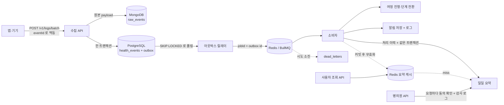

# Carelog

건강 기록(혈당·식사·활동)을 받아 일일 요약·프로그램(여정) 진행·알림을 만드는 로깅 백엔드 데모입니다. NestJS(TypeScript)로 만든 모듈형 모놀리스이고, 화면 없이 백엔드 설계·테스트·관측에 집중했습니다.

> 모든 데이터는 합성 데이터입니다. 의료 조언이나 진단 도구가 아니며, 요약·알림 기준은 시연용 규칙입니다.

## 무엇을 하나

- **멱등 수집**: `POST /v1/logs/batch` 로 앱·기기가 기록을 묶어 보냅니다. 클라이언트가 만든 `eventId` 로 중복을 막고, 오프라인 동기화로 늦게·순서가 뒤바뀌어 온 기록도 측정 시각 기준으로 맞게 반영합니다.
- **이벤트 기반 후처리**: 기록과 같은 트랜잭션으로 아웃박스에 남기고, 릴레이가 큐(BullMQ)로 발행하면 소비자가 요약·여정·알림을 만듭니다. 재시도하고, 끝내 실패하면 dead-letter 로 보냅니다.
- **조회**: 내 타임라인(커서 페이지네이션), 일일·주간 요약(Redis 캐시), 여정 현황, 알림.
- **병의원(B2B) 접근 통제**: 사용자가 동의한 병의원만 요약을 볼 수 있고, 철회하면 즉시 막힙니다. 모든 조회(거부 포함)는 감사 로그에 남습니다.
- **관측**: 요청 ID 가 붙는 JSON 로그, `/health`, Prometheus `/metrics`, OpenAPI(`/docs`).

## 구조



| 저장소 | 맡은 일 |
|---|---|
| PostgreSQL | 정규화된 기록, 아웃박스, 처리 이력, 요약·여정·알림, 동의, 감사 로그. 트랜잭션이 필요한 모든 것 |
| MongoDB | 기기가 보낸 원본 payload(`raw_events`, 키 `userId:eventId`, 전달 횟수 `deliveries`). 스키마가 바뀌어도 원본을 보존 |
| Redis | BullMQ 큐, 요약 캐시(TTL 60초 + 소비자 커밋 뒤 무효화) |

## 5분 실행

필요한 것: Node 24, Docker. (부하 스크립트만 [k6](https://grafana.com/docs/k6/latest/set-up/install-k6/) 필요)

```bash
npm ci
make up         # PostgreSQL·MongoDB·Redis·앱 기동 (앱 http://localhost:53100, 호스트 포트 53100·55432·55017·56379)
make simulate   # 데모 계정 시드 후 가상 CGM·식사 기록 전송, 요약·여정·알림이 생겼는지 확인
make down       # 정리(볼륨 포함)
```

`make simulate` 출력 예(합성 데이터, 3일치):

```
수집 결과: 저장 876, 중복 차단 70, 거부 3
일일 요약 2026-11-20: 측정 288회, 평균 125.8 mg/dL, 목표 범위 89.9%, 식후 급상승 3회
여정: 2/4주차, 전환 1회
알림: 저혈당 7건, 고혈당 6건
```

같은 명령을 다시 실행하면 같은 `eventId` 를 보내므로 전부 중복으로 차단됩니다(저장 0).

직접 호출해 보기:

```bash
TOKEN=$(curl -s localhost:53100/v1/auth/login -H 'content-type: application/json' \
  -d '{"email":"user1@demo.test","password":"demo1234"}' | jq -r .accessToken)
curl -s localhost:53100/v1/me/summary/daily -H "authorization: Bearer $TOKEN"
curl -s localhost:53100/v1/me/journey -H "authorization: Bearer $TOKEN"
open http://localhost:53100/docs    # Swagger UI
```

시드 계정(비밀번호 `demo1234`): 사용자 `user1@demo.test` … `user10@demo.test`, 병의원 `clinic1@demo.test`, `clinic2@demo.test`(로그인 요청에 `"role":"clinic"`).

## API 요약

| 경로 | 설명 |
|---|---|
| `POST /v1/auth/login` | 시드 계정 로그인(JWT, 역할 user·clinic) |
| `POST /v1/logs/batch` | 기록 배치 수집(최대 500건). 잘못된 항목만 `rejected` 로 돌려줌 |
| `GET /v1/me/timeline?limit&cursor` | 내 기록, 측정 시각 내림차순 커서 페이지네이션 |
| `GET /v1/me/summary/daily?date` · `/weekly?date` | 평균 혈당, 목표 범위 내 비율, 식후 급상승 횟수 |
| `GET /v1/me/journey` · `/alerts` | 프로그램 진행률·단계 전환, 저·고혈당 알림 |
| `POST /v1/me/consents` · `DELETE /v1/me/consents/:clinicId` · `GET /v1/me/access-log` | 동의·철회, 내 데이터 조회 기록 |
| `GET /v1/clinic/patients` · `/patients/:userId/summary/daily` · `/weekly` | 병의원: 동의한 환자만 |
| `GET /health` · `/metrics` · `/docs` | 저장소 상태, Prometheus 지표, OpenAPI |

## 설계 결정

**ORM 대신 Kysely.** 이 시스템의 핵심 쿼리는 `ON CONFLICT DO NOTHING RETURNING`, `FOR UPDATE SKIP LOCKED`, 어드바이저리 락, 튜플 비교 커서(`(measured_at, id) < (…)`)처럼 SQL 이 그대로 보여야 의미가 읽히는 것들입니다. 엔티티 매핑이 이를 가리기보다, 타입 검사되는 SQL 빌더가 낫다고 판단했습니다. 스키마는 `src/db/schema.ts` 의 DDL 한 벌이고 기동 시 멱등하게 적용합니다.

**NestJS 11.** 지금 npm 최신은 12 지만 ESM 전용입니다. 이 프로젝트는 Jest 로 통합 테스트를 돌리고 Node 24 의 `require(esm)` 로 ESM 전용 패키지(Kysely)를 읽는 CommonJS 구성이라, 도구 체인이 안정적인 11 을 골랐습니다.

**멱등 키는 `(user_id, event_id)`.** `eventId` 는 클라이언트가 기록을 만들 때 정합니다(예: 기기 ID + 측정 시각). 서버는 `UNIQUE (user_id, event_id)` 와 `ON CONFLICT DO NOTHING` 으로 한 번만 저장하고, 새로 저장된 행만 아웃박스로 보냅니다. 사용자별 키라서 다른 사용자의 같은 ID 가 서로를 막지 않습니다. 같은 배치 안의 중복도 먼저 걸러냅니다. 원본 저장소(Mongo)도 `userId:eventId` 를 `_id` 로 upsert 하므로 재시도해도 문서가 늘지 않고 `deliveries` 만 오릅니다. Mongo 에 쓴 뒤 PG 가 실패해도 같은 요청을 다시 보내면 이어집니다.

**순서 역전은 "도착 순서"를 믿지 않는 계산으로.** 모든 기록은 `measured_at` 으로 저장·정렬합니다. 요약·여정은 메시지를 하나씩 누적하지 않고, 영향받은 날짜(측정 시각 기준)의 저장된 기록에서 다시 계산합니다. 그래서 어떤 순서로 도착·처리돼도 결과가 같습니다(테스트로 확인). 같은 사용자의 메시지가 동시에 처리돼도 사용자 단위 어드바이저리 락으로 직렬화해 나중 계산이 항상 최신 데이터를 읽습니다. 여정은 앞으로만 전환하며, 1주차 중 더 오래된 기록이 늦게 오면 시작일을 앞당깁니다.

**아웃박스를 쓴 이유.** "기록 저장"과 "큐 발행"을 따로 하면 둘 중 하나만 성공하는 순간이 생깁니다. 기록과 같은 트랜잭션으로 아웃박스 행을 쓰면 저장이 곧 발행 약속이 됩니다. 릴레이는 `FOR UPDATE SKIP LOCKED` 로 미발행 행을 잠가 여러 인스턴스가 떠도 겹치지 않고, `jobId = outbox id` 로 큐에 넣어 "넣고 표시 직전에 죽은" 경우의 재발행이 큐 안에서 합쳐집니다. 그래도 한 번 이상 전달(at-least-once)이므로 소비자가 중복에 안전해야 합니다.

**소비자 안전장치.** (1) `processed_messages (consumer, outbox_id)` 에 같은 트랜잭션으로 처리 표시를 남겨 재전달을 건너뜁니다. (2) 알림은 `(user_id, event_id)` 유니크라 다른 메시지로 다시 와도 한 번만 만듭니다. (3) 실패는 지수 백오프로 재시도하고, 시도를 모두 소진하면 `dead_letters` 에 원본 메시지와 사유를 남깁니다. 알림은 실제 발송 대신 저장과 구조화 로그만 합니다.

**요약 캐시.** 조회는 Redis 를 먼저 보고(TTL 60초), 소비자가 커밋한 뒤 해당 날짜·주 키를 지웁니다. 무효화가 실패해도 TTL 이 최대 지연의 상한입니다.

**동의·감사(B2B).** 병의원 요청은 매번 DB 에서 활성 동의를 확인합니다(캐시 없음). 그래서 철회가 즉시 반영되고, 요약 캐시가 남아 있어도 막힙니다. 동의 없음과 존재하지 않는 사용자는 같은 404 로 답해 존재 여부를 드러내지 않습니다. 사용자 API 는 입력으로 사용자 ID 를 받지 않고 JWT 의 `sub` 만 쓰므로 다른 사용자를 가리킬 방법이 없고, 병의원 API 는 동의 확인이 곧 접근 통제입니다. 두 경우 모두 IDOR 테스트가 있습니다. 감사 로그에는 허용·거부 모두 병의원·환자·동작·요청 ID 가 남고, 사용자는 `GET /v1/me/access-log` 로 자기 데이터가 조회된 기록을 봅니다.

## 관측

- 로그: 한 줄 JSON, 요청 ID(`x-request-id` 를 받거나 새로 만들어 응답 헤더로 돌려줌)가 로그에 자동으로 붙습니다.
- `/health`: PostgreSQL·MongoDB·Redis 각각 `up/down`, 하나라도 내려가면 503.
- `/metrics`(Prometheus):

| 지표 | 의미 |
|---|---|
| `carelog_events_ingested_total{kind}` · `carelog_events_duplicate_total` · `carelog_events_rejected_total` | 저장·중복 차단·거부 건수 |
| `carelog_outbox_pending` | 아직 큐로 발행되지 않은 아웃박스 행(적체) |
| `carelog_queue_delay_seconds` | 아웃박스 기록부터 소비자 처리 시작까지 걸린 시간 |
| `carelog_consumer_processed_total{result}` · `carelog_consumer_failures_total` · `carelog_dead_letters_total` | 소비 결과, 실패(재시도 포함), dead-letter |
| `carelog_alerts_total{kind}` · `carelog_summary_cache_total{result}` | 알림 생성, 캐시 적중·미스 |
| `carelog_http_request_duration_seconds` | 라우트별 HTTP 지연 |

## 테스트

총 **87건**: unit 33 · integration 51 · e2e 3. 통합·e2e 는 실제 PostgreSQL·MongoDB·Redis 를 쓰고(테스트용 DB·Redis DB·큐 이름은 개발용과 분리), e2e 는 릴레이·워커까지 띄워 수집→소비→조회를 확인합니다. 모든 행은 [docs/TEST_CASES.md](docs/TEST_CASES.md) 와 1:1 로 대응하고, `make verify` 가 행 수와 실제 테스트를 대조합니다.

```bash
make test       # unit + integration + e2e (저장소 3종을 자동으로 올림)
make verify     # lint + 타입 검사 + 전체 테스트 + 테스트 케이스 문서 대조 + 빌드
npm run test:unit   # DB 없이 도메인 로직만
```

## 부하 측정

수집 API 를 [k6](load/ingest.js) 로 고정 도착률로 두들긴 결과입니다(`make load`, `RATE`·`DURATION` 환경 변수로 조절). 장비: Apple M5, 메모리 16GB, macOS 26.2, Docker(OrbStack, 10 CPU / 7.8GB 할당). k6 v1.4.2 가 같은 장비에서 함께 돌았고 앱·PostgreSQL·MongoDB·Redis 는 각각 컨테이너 1개씩입니다. 요청마다 혈당 20건(약 10%는 직전 요청의 재전송), 측정 시각은 최근 3일에 흩어지고, 사용자 7명이 나눠 보냅니다. 30초씩 한 번씩 실행한 값이라 편차가 있을 수 있습니다.

| 시나리오 | 처리량 | 응답 시간 | 실패 | 소비자 적체 해소 |
|---|---|---|---|---|
| 초당 100요청(≈2,000건/s), 3,000요청 | 평균 100 req/s | 평균 7.2ms, p95 12.7ms, 최대 29.6ms | 0% | 부하 종료 후 15.7초 |
| 초당 300요청(≈6,000건/s), 8,909요청 | 평균 296 req/s(91건은 목표 도착률을 못 맞춰 누락) | 평균 15.3ms, p95 26.2ms, 최대 567ms | 0% | 부하 종료 후 304.7초 |

수집 API 자체는 두 경우 모두 여유가 있었지만, 소비자(요약·여정 재계산)가 병목입니다. 300 req/s 에서는 큐에 메시지가 쌓여 5분가량 걸려 따라잡았습니다. 처리 이력·재시도 정책이 있어 유실은 없지만 지연이 커진다는 뜻입니다(`carelog_queue_delay_seconds`, `carelog_outbox_pending` 으로 보입니다).

## 한계

- **소비자 처리량**: 위 측정대로, 한 인스턴스가 메시지마다 해당 날짜 전체를 다시 계산합니다. 같은 사용자·같은 날의 메시지를 합쳐 한 번만 계산(coalescing)하거나 증분 갱신으로 바꾸면 개선될 여지가 큽니다. 여정은 SQL 집계라 사용자 데이터가 쌓여도 메시지당 비용이 일정하지만, 일일 요약은 하루치 행을 읽습니다.
- **UTC 날짜 기준**: 요약의 "하루"와 주 시작(월요일)은 UTC 입니다. 사용자별 시간대는 다루지 않습니다.
- **목표 범위 내 비율**은 시간이 아니라 측정 개수 기준입니다(균등 간격 CGM 가정). 식후 급상승은 단순 규칙(식전 대비 +50 mg/dL, 2시간 이내)이라 의학적 기준이 아닙니다.
- **스키마 마이그레이션 도구 없음**: 기동 시 `CREATE TABLE IF NOT EXISTS` 로 적용하는 단일 DDL 입니다. 스키마 변경 이력 관리는 하지 않습니다.
- **인증은 데모 수준**: 시드 계정 로그인과 JWT 만 있고, 토큰 폐기·리프레시·외부 IdP·속도 제한은 없습니다. 병의원 환자 목록 조회는 감사 로그에 남기지 않습니다(ID·표시 이름만 노출).
- 알림은 저장과 로그만 하고 실제 푸시·SMS 는 보내지 않습니다. 단일 노드 구성이며 클라우드 배포·CI 워크플로는 포함하지 않았습니다.
- 캐시 무효화는 커밋 뒤 best-effort 입니다. 무효화 직전에 읽던 요청이 캐시를 다시 채우면 TTL(60초) 동안 이전 값이 보일 수 있습니다.
